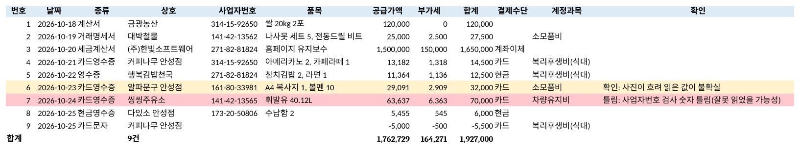

<p align="center"></p>

# 영수증 장부 플러그인 (receipt-ledger)

**영수증 사진, 세금계산서 PDF, 카드 승인 문자를 Claude에게 올리면 검사까지 끝난 엑셀 장부로 만들어 주는 무료 플러그인입니다.**

> **English**: A free Claude plugin that turns Korean receipts, card slips, cash receipts, tax invoices (세금계산서), statements (거래명세서) and card-approval SMS into a checked Excel ledger. Claude reads the photos; the tool prepares images (deskew, sharpen faded thermal paper), extracts text from PDFs, validates business registration numbers and supply + VAT = total, finds duplicates, guesses account categories, and builds ledger / monthly / vendor / category / VAT-evidence sheets.

<p align="center"><br><sub>만들어진 장부 — 흐린 영수증은 노랑, 사업자번호가 틀린 영수증은 빨강 (가짜 영수증으로 만든 예시)</sub></p>

## 이런 분께

- 한 달 치 영수증 사진을 엑셀에 하나하나 옮겨 적는 분
- 부가세 신고 전에 세금계산서·카드영수증을 정리해야 하는 자영업자·프리랜서
- 법인카드 사용 내역을 증빙과 맞춰 봐야 하는 회사원

## 할 수 있는 일

| 이렇게 말하면 | 이렇게 해 줍니다 |
|---|---|
| "이 영수증 사진들 엑셀로 정리해 줘" | 날짜·상호·사업자번호·품목·공급가액·부가세·합계·결제수단을 칸마다 |
| "세금계산서 PDF 정리해 줘" | PDF 글자를 꺼내 바로 채우고 그림과 견줘 확인 |
| "카드 문자로 지출 정리해 줘" | 신한·국민·삼성·현대·롯데·하나·우리·BC·농협 승인 문자, 취소는 마이너스 |
| "틀린 거 없나 봐 줘" | 사업자번호 검사 숫자, 공급가액+부가세=합계, 부가세 10%, 날짜 |
| "중복 있는지 봐 줘" | 같은 영수증 두 장, 카드 문자와 영수증이 겹친 것 |
| "월별·거래처별로 보고 싶어" | 월별·거래처별·계정과목별·증빙별 합계 시트 |
| "지난달 장부에 이어서" | 이미 있는 거래는 빼고 새 거래만 더함 |

흐린 감열지 영수증은 **선명하게 만든 그림**을 따로 만들어 읽습니다. 그래도 안 보이는 숫자는 지어내지 않고 비워 두고 노랗게 표시합니다. 카드번호는 끝 4자리만 남깁니다.

## 설치

Claude Code에서:

```
/plugin marketplace add rlawhddja1231-hash/receipt-ledger
/plugin install receipt-ledger@receipt-ledger
```

Claude 앱(claude.ai)에서는 `skills/receipt-ledger` 폴더를 압축해 **설정 → 기능 → 스킬**에 올리면 됩니다.

처음 쓸 때 Claude가 필요한 파이썬 패키지를 알아서 설치합니다:

```
pip install openpyxl pypdf pypdfium2 pillow
```

## 시험 결과 (2026-10-25)

- 가짜 영수증 10가지(카드영수증, 현금 영수증, 흐리고 기울어진 감열지, 사업자번호가 틀린 영수증, 같은 영수증을 다시 찍은 사진, 전자세금계산서 PDF, 면세 계산서 PDF, 글자 없는 스캔 거래명세서 PDF, 카드 문자 4건)를 처음부터 끝까지 돌림
  - 9건 장부, 합계 1,927,000원 — 손으로 더한 값과 같음
  - 틀린 사업자번호 1건, 흐린 영수증 1건, 중복 4건(다시 찍은 사진 1, 카드 문자와 영수증 겹침 3)을 모두 잡음
- 지난 장부에 이어 쓰기: 이미 있는 거래는 다시 넣지 않음
- 만든 사람과 다른 검사 담당이 까다로운 파일로 다시 시험 → 찾은 문제를 고침

자세한 기록은 [`skills/receipt-ledger/references/log.md`](skills/receipt-ledger/references/log.md)에 있습니다.

## 못 하는 것

- 세금 계산, 공제 판단, 신고서 작성 (계정과목·부가세 시트는 정리용 짐작과 합계일 뿐입니다 — 신고는 세무사나 홈택스 기준으로 확인하세요)
- 홈택스·카드사에서 자료 받아 오기 (내려받은 파일은 읽을 수 있습니다)
- 손글씨·많이 구겨진 영수증을 틀림없이 읽기 (확인 필요로 표시합니다)

## 직접 써 보기 (명령어)

```
L=skills/receipt-ledger/scripts/rledger.py
python3 $L prep  examples/ --out 작업          # 읽을 준비 → 작업/입력.json, 작업/작업목록.md
python3 $L check 작업/입력.json                # 검사
python3 $L build 작업/입력.json --out 장부.xlsx --drop-dupes
python3 $L build 새입력.json --into 장부.xlsx --out 장부_11월.xlsx
python3 $L sms   examples/예시_카드문자.txt
```

`examples/` 의 영수증·세금계산서·카드 문자는 모두 가짜입니다.

## 개인정보

영수증과 장부는 사용자의 컴퓨터(또는 Claude 작업 공간) 밖으로 나가지 않습니다. 인터넷 연결도 하지 않습니다. 자세한 것은 [PRIVACY.md](PRIVACY.md).

## 라이선스

MIT
